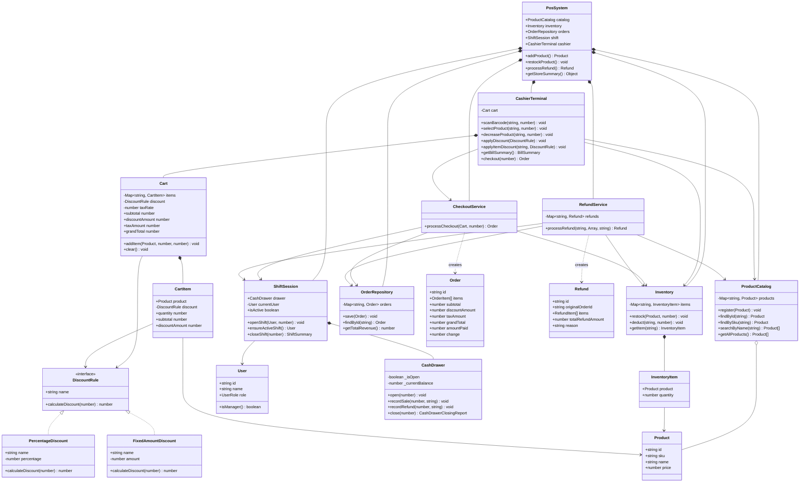

# Point of Sale System (TypeScript)

Sistem simulasi **Point of Sale (PoS)** ritel yang dirancang menggunakan prinsip **Object-Oriented Programming (OOP)**, _Single Responsibility Principle (SRP)_, _Strategy Pattern_, dan _Facade Pattern_ untuk memisahkan logika bisnis inti dari antarmuka pengguna (CLI).

## 1. Arsitektur & Pembagian Tanggung Jawab Kelas

Seluruh komponen di dalam repositori ini dibagi berdasarkan peran bisnis yang spesifik agar mudah diuji dan dikembangkan:

### Pintu Masuk Utama (_Facade_):

**`PosSystem`**: Merakit dan menghubungkan seluruh sub-sistem (_catalog, inventory, orders, shift, cashier_) ke dalam satu antarmuka terpusat sehingga lapisan UI/CLI tidak perlu mengelola _dependency_ secara manual.

### Master Data & Gudang:

**`Product` & `ProductCatalog`**: Menyimpan daftar menu/katalog produk toko (ID, SKU/Barcode, nama, harga) beserta fitur pencarian berdasarkan ID, SKU, maupun nama.

**`Inventory` & `InventoryItem`**: Mengelola jumlah stok fisik barang yang tersedia dan mencatat pengurangan stok saat penjualan maupun penambahan stok saat _restock_ atau retur.

### Operasional Kasir & Kalkulasi:

**`CashierTerminal`**: Antarmuka operasional meja kasir untuk memindai produk, mengatur kuantitas, menerapkan promo diskon, dan memproses pembayaran.

**`Cart` & `CartItem`**: Menyimpan daftar belanja aktif dan menghitung subtotal, diskon per item, diskon keranjang, serta pajak secara otomatis.

**`DiscountRule` (`PercentageDiscount`, `FixedAmountDiscount`)**: Implementasi _Strategy Pattern_ untuk menghitung potongan harga secara fleksibel.

### Transaksi, Retur, & Akuntabilitas Keuangan

**`CheckoutService`**: Memvalidasi shift aktif dan pembayaran, memotong stok di `Inventory`, mencatat uang masuk ke `CashDrawer`, serta menerbitkan struk `Order`.

**`Order`, `OrderItem`, & `OrderRepository`**: Menyimpan riwayat struk penjualan yang bersifat _immutable_ (tidak dapat diubah setelah terbit).

**`RefundService`, `Refund`, & `RefundItem`**: Mengelola retur barang berdasarkan struk asal, menghitung nominal pengembalian secara **prorata** (memperhitungkan porsi diskon keranjang dan pajak), serta mengembalikan stok jika barang masih layak jual.

**`User`, `ShiftSession`, & `CashDrawer`**: Mengikat identitas kasir yang bertugas dengan laci kas fisik, mencatat modal awal, mutasi uang masuk/keluar, hingga menghitung selisih kas (_discrepancy_) saat tutup shift.

## 2. Alur Kerja Sistem (_End-to-End Flow_)

```
[1. Inisialisasi]
   PosSystem() merakit Catalog, Inventory, OrderRepository, ShiftSession, & CashierTerminal
        │
        ▼
[2. Buka Shift Kasir]
   User (Kasir) ──► ShiftSession.openShift(user, modalAwal) ──► CashDrawer dibuka
        │
        ▼
[3. Proses Belanja (CashierTerminal)]
   Scan SKU / Pilih ID ──► Cek Catalog ──► Cek Stok Inventory ──► Masuk Cart
        │
        ▼
[4. Kalkulasi Tagihan (Cart)]
   Subtotal (setelah diskon item) ──► Potong Diskon Keranjang ──► Tambah Pajak ──► Grand Total
        │
        ▼
[5. Checkout & Pembayaran (CheckoutService)]
   Validasi Shift & Uang Bayar ──► Potong Stok Inventory ──► Catat Kas Masuk (CashDrawer)
        │
        └──► Terbitkan Struk (Order) & Simpan ke OrderRepository ──► Reset Cart
        │
        ▼
[6. Retur Barang / Opsional (RefundService)]
   Cek Order Asal ──► Validasi Sisa Kuota Retur ──► Hitung Refund Prorata
        │
        └──► Kembalikan Stok (jika layak jual) ──► Catat Kas Keluar (CashDrawer)
        │
        ▼
[7. Tutup Shift]
   ShiftSession.closeShift(uangFisik) ──► CashDrawer menghitung selisih kas (Discrepancy)

```

## 3. Diagram UML Class



### Panduan Singkat Simbol Garis pada Diagram

- **`*--`** **(Komposisi)**: Kelas utama memiliki dan bertanggung jawab penuh atas siklus hidup kelas bagiannya (misalnya `PosSystem` merakit `ShiftSession`, dan `ShiftSession` memiliki `CashDrawer`).
- **`o--`** / **`-->`** **(Agregasi / Asosiasi)**: Kelas saling berinteraksi atau menyimpan referensi tanpa memiliki siklus hidupnya secara eksklusif (misalnya `CartItem` merujuk ke `Product`).
- **`<|..`** **(Implementasi Interface)**: `PercentageDiscount` dan `FixedAmountDiscount` mengimplementasikan kontrak `DiscountRule`.
- **`..>`** **(Dependensi / Membuat Objek)**: `CheckoutService` menghasilkan objek `Order`, dan `RefundService` menghasilkan objek `Refund`.
